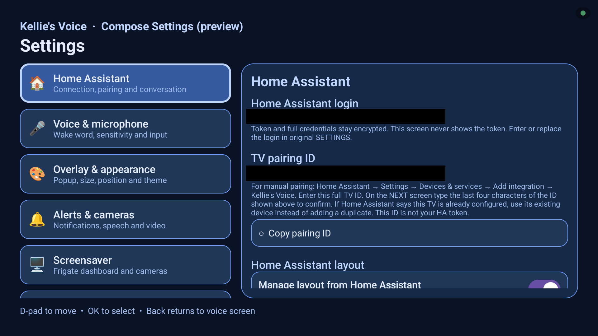
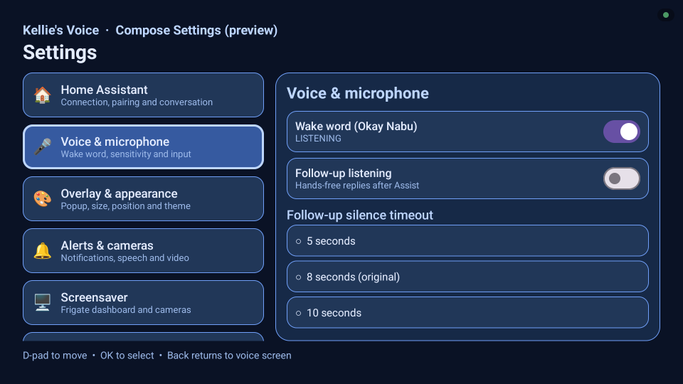
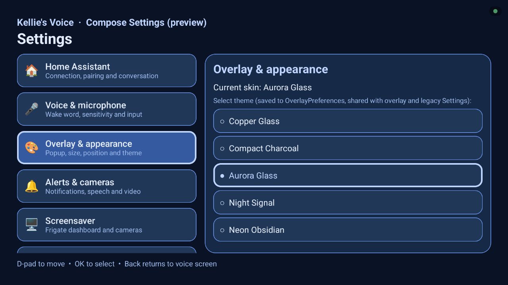
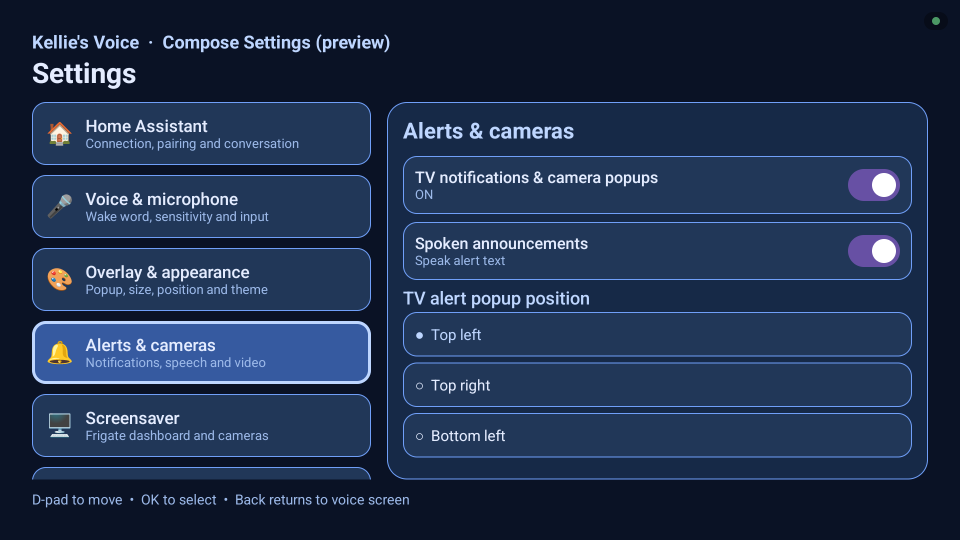
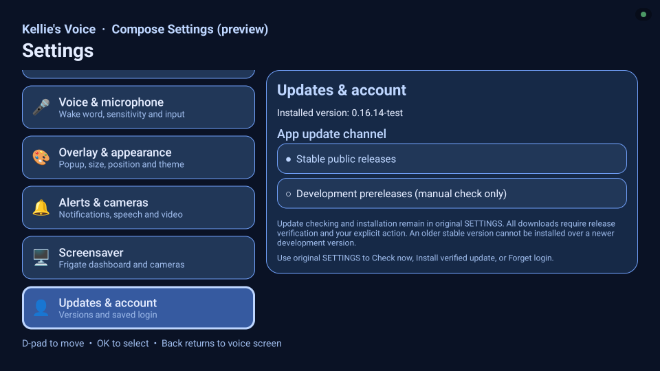
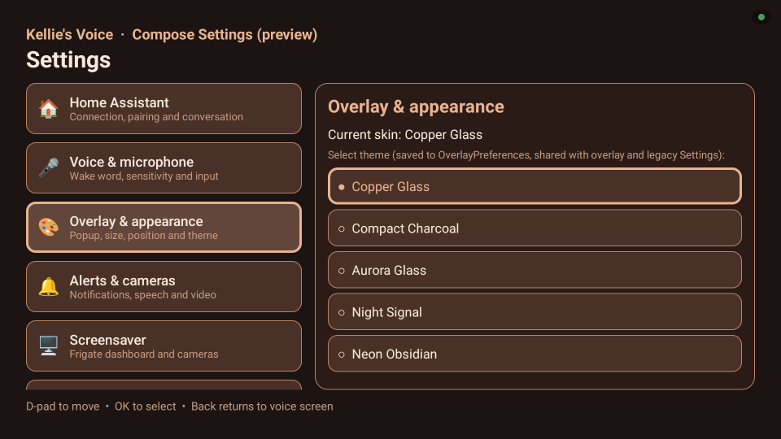
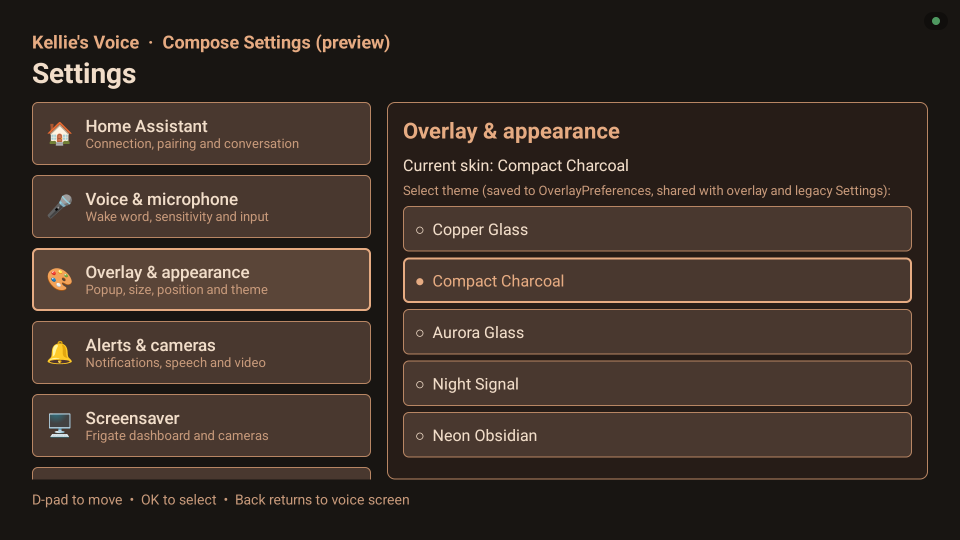
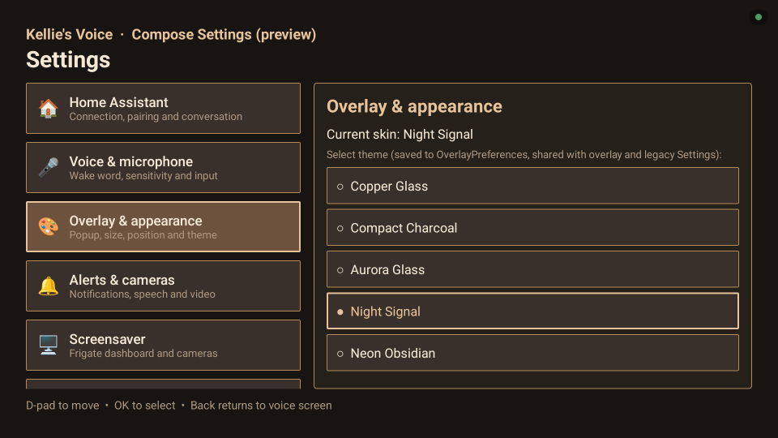
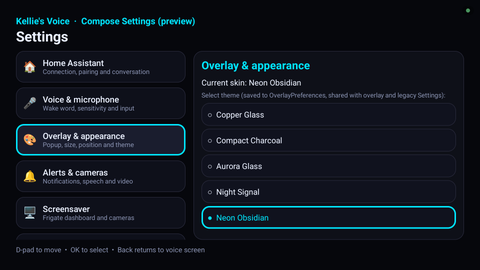
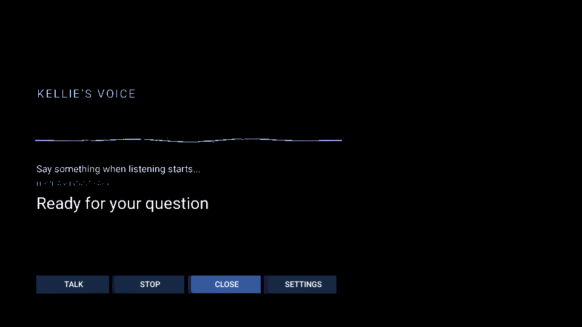

# Direct onn 4K Pro captures — PR #192

Captured October 28, 2026 through onn-tv-adb from the existing **0.16.14-test debug APK (version code 54)**. These are actual device captures with privacy redactions, not UI mockups. **Compose is a development-only preview, not released Settings.** The installed APK predates the latest PR #192 popup/theme fixes; these images do not verify those fixes. Its exact source commit was not established. The production app and installed APKs were not modified.

Private addresses, identifiers, camera names/footage, faces and background artwork are masked where present. Opaque redactions preserve source pixels elsewhere; the overlay uses additional background-pixel masking. The generative masking trial and unsolicited doorbell-alert frame are excluded. No raw files are included. Theme was restored to Aurora Glass. Auto-listen was restored to its original ON value after the owner-authorized idle capture.

## Home Assistant category

Compose development preview. Local host/address and pairing identifier are covered by opaque masks.

## Voice & microphone category

Compose development preview. LISTENING is this TV’s existing opted-in wake-word state, not the default. No wake setting was changed.

## Overlay & appearance — Aurora Glass

Compose development preview with Aurora Glass selected. This is the original theme restored after capture.

## Alerts & cameras category

Compose development preview showing the existing alert and spoken-announcement switches and Top left selection. No spoken test was invoked.

## Screensaver category

Compose development preview. Private camera entity names masked; Frigate web URL unconfigured.

## Updates & account category

Compose development preview showing installed 0.16.14-test and Stable public releases selected. No update performed.

## Copper Glass selected

Actual local theme selection in the installed Compose development preview.

## Compact Charcoal selected

Actual local theme selection in the installed Compose development preview.

## Night Signal selected

Actual local theme selection in the installed Compose development preview.

## Neon Obsidian selected

Actual local theme selection in the installed Compose development preview. The installed HA theme catalog lacked Neon; this is not evidence of HA synchronization or released support.

## Local announcement sample

Built-in Preview announcement popup over Compose development settings, using neutral sample text. Not a new HA delivery or spoken-audio test.

## Idle voice overlay — heavily redacted

Original foreground text, waveform and opaque controls retained at captured positions. Launcher artwork, surrounding content and translucent background pixels masked. Does not show complete card styling. Auto-listen temporarily OFF with owner permission, then restored ON; TALK not pressed.

## Screensaver preview — camera area fully masked

Entire camera-content region including footage, labels and timestamps covered. Only the genuine Close control is retained. Not evidence of moving playback, camera layout or decoder reliability. Preview closed with Back.
