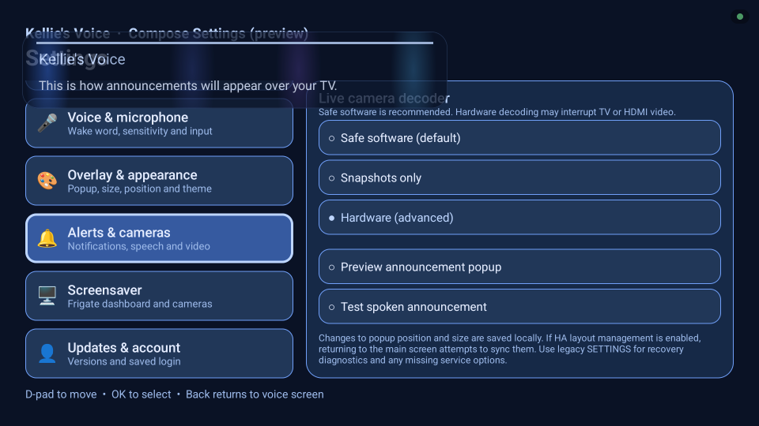

# Announcements and Weather

[← Documentation home](Home.md) · [Getting started](Getting-Started.md) · [YAML Cookbook](YAML-Cookbook.md) · [Troubleshooting](Troubleshooting.md)

---

## Text announcements

Home Assistant can send quiet on-screen text popups with `kellies_voice.announce`. They remain **silent by default**. In v0.16.11, an optional short `speak` argument to `kellies_voice.announce` speaks a sentence through the TV. TV **Settings → Announcement voice volume** controls separate 20–100% spoken gain (60% default). The maintainer verified 40% sounded quieter in a local test and a real Home Assistant announcement on onn 4K Pro. Audio ducking and alternate devices still need physical verification.

Example and placement notes are in the [YAML Cookbook](YAML-Cookbook.md#announcements).

Enable **SETTINGS → Alerts & cameras → TV notifications & camera popups** on the TV and ensure the alert receiver is connected.

## Actual on-TV local preview capture

Captured on an onn 4K Pro running the existing **0.16.14-test debug APK**, October 28, 2026, using **COMPOSE → Alerts & cameras → Preview announcement popup**. The underlying Compose page is a **development-only preview**, not released Settings. This is the built-in local visual sample, not a new HA-delivery or spoken-audio test. The APK predates the latest PR #192 popup-theme fixes, so the image does not verify their parity. [Capture gallery](../screenshots/PR-192-CAPTURES.md).

## Seven-day weather card

`kellies_voice.show_forecast` displays a seven-day forecast card using a Home Assistant weather entity that supports daily forecasts. It is on-demand only (not automatic). The card does not start the microphone or change TV audio.

Set a default **Forecast source** on the Kellie's Voice device page, or pass `entity_id` in the action. Position, size, and duration of the weather card are controlled separately from the voice overlay and camera popups.

Full script and action examples: [YAML Cookbook](YAML-Cookbook.md#seven-day-weather-forecast) and the repository's [docs/WEATHER_FORECAST.md](https://github.com/chadakenn/Kellies-Voice/blob/main/docs/WEATHER_FORECAST.md).

Confirmed working on the maintainer's onn 4K Pro. Other weather integrations and TV models need testing.

## Next

- [YAML Cookbook](YAML-Cookbook.md)
- [TV App and Permissions](TV-App-and-Permissions.md)

---

[← All documentation](Home.md) · [Next: YAML Cookbook →](YAML-Cookbook.md)
