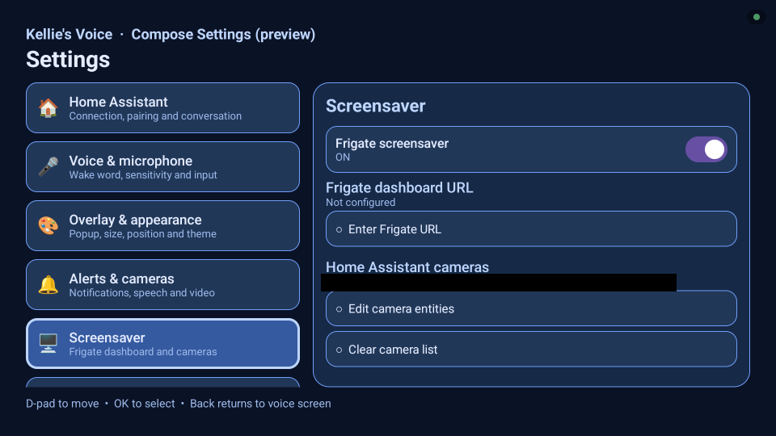

# Cameras and Frigate

[← Documentation home](Home.md) · [Getting started](Getting-Started.md) · [YAML Cookbook](YAML-Cookbook.md) · [Troubleshooting](Troubleshooting.md)

---

Kellie's Voice can show camera snapshots, opt-in HLS camera overlays, and an optional automatic screensaver with up to four muted live cameras.

## What it looks like on the TV

These photos are from the owner's onn 4K Pro in October 2026. The four-camera grid and the Frigate website are included in the **stable v0.16.14** release (introduced in v0.16.12), opt-in and subject to camera/decoder compatibility. The home camera feeds and event strip are deliberately obscured for privacy.

The diagnostics photo is an example of the status screen, not a working screensaver. Here the watcher is stopped, Home Assistant layout sync has not started, and Android has not sent a dream event.

## Additional direct ADB captures from PR #192 testing

Screensaver settings on the existing **0.16.14-test debug app**, captured October 28, 2026 on an onn 4K Pro. **This Compose settings page is a development preview**, not the released settings interface. Camera entity names are masked; the Frigate web URL was unconfigured.

The screensaver preview opened from that development UI. All camera imagery, tile labels, timestamps, faces and scene details are covered by one opaque mask; only the genuine **Close** control remains visible. This deliberately does not show the camera layout, prove moving video, or establish decoder reliability. Preview was closed with Back. No camera mode was changed. [Capture details](../screenshots/PR-192-CAPTURES.md).

## Live HA camera screensaver (opt-in; introduced in v0.16.12)

Enable **Frigate screensaver** and **Home Assistant layout** in the TV's Kellie's Voice settings and grant **Display over other apps**. Select up to four Home Assistant camera entities for the paired TV in Home Assistant. Leave the **Frigate web URL blank** to use the HA-selected grid; a Frigate URL takes priority and shows the Frigate website instead.

In the paired TV's Home Assistant controls choose **HA camera grid playback → Live (one camera)** first, then two or four (advanced) if the TV handles software-decoded HLS reliably. The overview is **muted**, and failed/unsupported HLS returns to snapshots. Use the remote D-pad to select a tile, press **OK** for full-screen and that camera's audio if the stream contains an audio track, and press **Back** to restore the muted 2×2 grid. **Close** ends the viewer. The focused footer control has a gold outline.

On the maintainer's onn Google TV, all four live cameras launched automatically and returned after reboot. Full-screen Doorbell audio, remote Back and focus were field-tested. This does **not** establish other devices, all decoders or audio tracks. See [Frigate screensaver setup](https://github.com/chadakenn/Kellies-Voice/blob/main/docs/FRIGATE_SCREENSAVER.md) for the diagnostics and Resync HA cameras recovery.

## Snapshot popups

Use `kellies_voice.show_camera`. This is a still image. Optional parameters (v0.16.5+):

- `show_header: false` — hide title and caption
- `image_fit: fit` — show the entire frame (letterboxed) instead of cropping
- `refresh_seconds: 3` — periodically update the still (2–30 seconds)

See full examples in the [YAML Cookbook](YAML-Cookbook.md#snapshot-camera).

## Live camera (experimental)

Use `kellies_voice.show_live_camera`. Moving video has been verified on the onn 4K Pro with driveway and doorbell cameras. Other devices and cameras need testing.

On Philips integrated TVs, prefer the **Safe software** live-camera mode in TV Settings so the hardware decoder stays available for HDMI/Netflix. Hardware mode is opt-in and can disrupt HDMI.

Short durations (down to 4 seconds) and the same header/fit/refresh options are supported in v0.16.7+. A very short popup may close before the first HLS frame arrives.

## Hide a camera

`kellies_voice.hide_camera` dismisses the current camera popup immediately.

## Frigate person detection

Use the included blueprint `frigate_person_popup.yaml` or a simple automation that calls `show_camera` when a Frigate person occupancy sensor turns on. This produces a **snapshot**, not live video.

Full YAML is in the [YAML Cookbook](YAML-Cookbook.md#frigate-person-automation--blueprint).

## Voice control of cameras

Create clearly named scripts (e.g. "Show doorbell camera live on TV") and expose them to Assist. Parameterized durations are less reliable with some conversation agents; fixed-duration scripts are more dependable. See the repository's [docs/VOICE_CAMERA_SCRIPTS.md](https://github.com/chadakenn/Kellies-Voice/blob/main/docs/VOICE_CAMERA_SCRIPTS.md) for complete script examples.

## Next

- [YAML Cookbook](YAML-Cookbook.md)
- [Troubleshooting](Troubleshooting.md)

---

[← All documentation](Home.md) · [Next: YAML Cookbook →](YAML-Cookbook.md)
